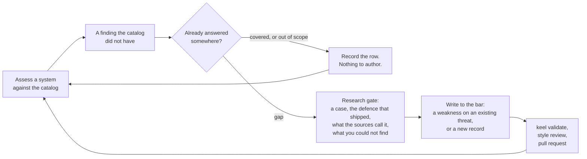

# Authoring

Writing into the model is gated in three places, and they check different kinds of thing. Confusing them is how a catalog fills up with fluent cards that cite nothing.

## Where new content comes from

An assessment is not the end of the work. A finding the catalog did not have is marked as new in the report, and that mark is what the next authoring pass is for.



Most of what arrives is already answered, so the loop starts by finding out. That step ends as a row in the coverage matrix, and a row is a real output: it is how the model says what it deliberately does not cover without that reading as an omission.

When it is a genuine gap, the authoring skill will not let the writing start until the research is done. It has stopped the author mid-card more than once.

## The research gate

The `folding-into-the-model` skill will not let the writing start until the research is done. Four questions, and the fourth is answered even when the first three are not.

This is a real run, and it ends in a stop:

```
> Fold this in: an agent's scheduled task keeps running under its own
> authority after the person who created it has lost access.

folding-into-the-model

Step 1 - what kind of thing is it, and is it already answered?
  search("standing authority after revocation")   -> T-CRED-THEFT (adjacent)
  search("scheduled agent task stale grant")      -> nothing that answers it
  get_coverage(source_id="owasp-agentic")         -> ASI03 covered by T-CRED-THEFT

  T-CRED-THEFT is a privileged action running under the agent's identity at
  someone else's request. This is the agent's own grant outliving the grantor.
  Different chain, different rule-out. Disposition: partial gap. Carry on.

Step 2 - the research gate (research.md)
  1. Name a case: where, what happened, what made it possible.   NOT FOUND
  2. Name the defence that was actually adopted.                 NOT FOUND
  3. What the tracked sources call it, in their words.           ASI03, read
  4. What you looked for and did not find.                       (below)

  Stopping here rather than writing. Searched the AI Incident Database, the
  ATLAS case studies attached to AML.T0053, and vendor advisories for agent
  schedulers. Everything I found is a list saying the risk exists. Writing the
  card now would produce something fluent that cites nothing, and the per-field
  review would pass it, because fluency is exactly what a card written from
  memory has.

  Two ways on, your call:
    a) keep looking, with terms you suggest
    b) write it as a weakness on T-CRED-THEFT with the absence recorded, so the
       card carries less weight and nobody repeats this search
```

The gate has caught its own author. A search summary once reported a named feature shipped by a major vendor; it read well and it was specific, and the feature does not exist under that name. Nothing got written. Without the gate you get cards that read beautifully and cite nothing, and no reviewer can tell the difference by reading them.

## What a machine can decide

`keel validate` runs on every change, locally and in CI. It checks what a reviewer should not have to: schema, frozen vocabularies, link integrity, id and filename agreement, and coverage rows that name a record no longer there.

```console
$ uv run keel validate
Warnings (350):
  ! CTRL-ACCESS-CONTROL: no scope
  ! CTRL-ACCESS-CONTROL: no out_of_scope
  ! CTRL-ACCESS-CONTROL: no locus
  ! CTRL-ACCESS-CONTROL: no failure_behavior
  ! CTRL-ACCESS-CONTROL: no validation: a control nobody can check is a recommendation
  ! CTRL-ARG-VALIDATION: no threat links this control
  ...
Catalog is valid.
```

Warnings never fail the build on their own, because an unfinished card is not a broken one. Errors do:

```console
$ uv run keel validate
Catalog invalid (1 problem(s)):
  - threat/T-TOOL-ABUSE: links 'CTRL-TOOL-ALLOWLISTS', which is not in the catalog
$ echo $?
1
```

`keel validate --strict` treats the warnings as errors too, which is the switch to reach for once a fork has finished the cards it cares about.

## What no rule can decide

Whether a sentence is any good.

The rule registry deliberately holds nothing about the wording of a field. Whether a `purpose` merely restates the name is semantics; it cannot be decided mechanically, and a rule that tried would only ever guess. Matching prose against a word list is the same mistake wearing a regular expression.

That job belongs to the style guide: a reviewer reads the entry against the per-field bar and the record-level tests before the work is reported as done. The review applies the bar and does not own it: if a field is wrong and the bar is silent, the fix is to the bar.

So the three layers are:

| Layer | Decides | Runs |
| --- | --- | --- |
| `keel validate` | structure, vocabularies, links | every change, and CI |
| `pytest` | Keel's own code | every change, and CI |
| style review | prose and meaning | when a record is written or changed |

## A rule earns its place by catching something

A rule is admitted to the registry after it has caught a real record, not because the failure it describes is imaginable. The style guide's own admission tests are in [`catalog/style_guide/README.md`](../catalog/style_guide/README.md).
